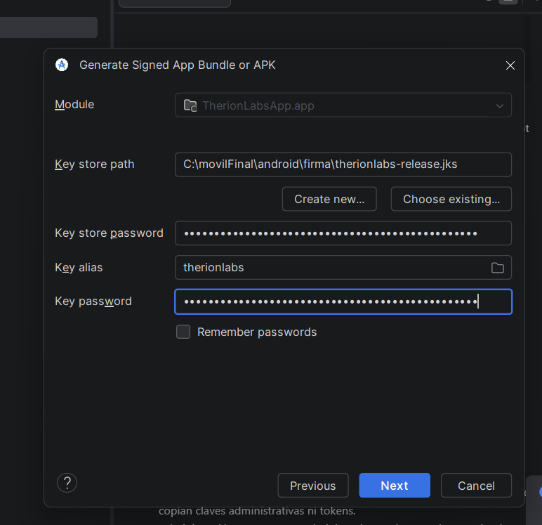
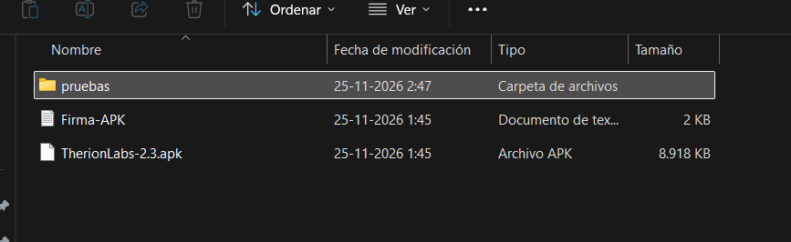

# TherionLabs · Valparaíso

Aplicación Android para organizar eventos de captación, registrar prospectos y gestionar su seguimiento en la Región de Valparaíso. El backend Spring Boot centraliza los datos en MySQL y permite compartirlos entre dispositivos al actualizar o sincronizar.

Durante una feria vocacional, los captadores necesitan registrar interesados aunque falle la conexión. Administración necesita reunir esas capturas, evitar duplicados y conservar el seguimiento de cada persona. Room permite continuar la captura en el teléfono y el servidor reúne la información cuando vuelve la conexión.

## Integrantes

Diego Barra, Franco Tubi, Maicol García y Benjamín Osorio.

## Funcionalidades

- Cada persona inicia sesión con una cuenta creada en el servidor. La aplicación recibe automáticamente el perfil y el código de captador; no se copian claves administrativas ni tokens.
- Administración crea cuentas administrativas o de captador, asociando cada captador a un código único como CAP-03. Un código de captador existente puede asociarse a una cuenta si aún no tiene una.
- Administración crea, consulta y edita eventos. Puede borrar eventos sin historial o cerrarlos para terminar la captación y conservar los prospectos y seguimientos.
- Los captadores descargan eventos abiertos y guardan fichas en Room sin conexión. Las capturas previas al cierre de un evento pueden enviarse después; el servidor rechaza capturas nuevas posteriores al cierre.
- WorkManager envía las capturas pendientes al recuperar conexión. Los reintentos mantienen el UUID original para evitar duplicados. Los rechazos conservan el motivo y permiten corregir los datos.
- Administración consulta los prospectos por evento, edita fichas, registra seguimientos, consulta estadísticas y exporta reportes Excel. No se borran fichas con gestiones registradas.
- Eventos muestra los abiertos por defecto y permite filtrar Abiertos, Cerrados o Todos. Registros conserva el historial completo, incluidos los eventos cerrados. La lista se actualiza mediante las opciones de actualización; no se utilizan notificaciones en tiempo real.
- La oferta académica está limitada a Valparaíso y Viña del Mar, con carreras según la sede.
- Cámara y ubicación son opcionales. Las fotos permanecen en el teléfono: enviar su ruta no transfiere el archivo a otros dispositivos.
- El clima se consulta mediante Retrofit a Open-Meteo; un fallo del proveedor no impide capturar ni sincronizar.

## Ejecución

### APK conectada a AWS

La versión de entrega es [TherionLabs 2.3](https://github.com/francotubi/therionlabs-android/raw/refs/heads/main/entrega/TherionLabs-2.3.apk). El archivo también está disponible en [entrega/TherionLabs-2.3.apk](entrega/TherionLabs-2.3.apk).

La aplicación se conecta por defecto a `https://184.192.154.68/`. El backend funciona en una instancia EC2 con MySQL y Nginx. El uso de la APK no requiere ejecutar el servidor en el computador.

El primer inicio de sesión necesita internet y una cuenta registrada en el servidor. Desde Cuentas, administración crea los usuarios administrativos o captadores. El perfil y el código de captador se reciben automáticamente al ingresar. Los eventos se descargan antes de trabajar sin conexión.

### Proyecto en Android Studio

El proyecto utiliza JDK 21 y Android SDK 36, revisión menor 1. La ejecución del módulo `app` en el emulador usa la dirección de AWS por defecto.

La compilación debug permite conexiones HTTP para las pruebas locales. La versión release utiliza HTTPS.

### Backend local

El [backend Spring Boot](https://github.com/francotubi/therionlabs-backend) utiliza MySQL y recibe su configuración mediante variables de entorno.

| Variable | Uso |
| --- | --- |
| `THERIONLABS_DB_URL` | Dirección JDBC de la base de datos MySQL |
| `THERIONLABS_DB_USER` | Usuario de la base de datos |
| `THERIONLABS_DB_PASSWORD` | Contraseña de la base de datos |
| `PORT` | Puerto del servicio; 8081 por defecto |
| `THERIONLABS_ADMIN_USER` | Usuario administrativo inicial |
| `THERIONLABS_ADMIN_PASSWORD` | Contraseña administrativa inicial |

La cuenta administrativa inicial se crea en la primera ejecución. Cambiar esas variables después no modifica una cuenta existente.

En el emulador, el backend del computador está disponible en `http://10.0.2.2:8081/`. La dirección se guarda desde Configurar servidor, en la pantalla de inicio de sesión, antes de descargar eventos o registrar prospectos. Un teléfono físico utiliza una dirección del backend accesible desde su red.

La aplicación conserva la dirección elegida y evita cambiar de servidor si ya existen eventos o registros locales, para no mezclar datos de instalaciones distintas.

## Sesiones y trabajo sin conexión

El primer acceso valida las credenciales en el backend. El teléfono conserva un resumen de la contraseña con sal, nunca la contraseña original. El captador puede volver a ingresar sin red durante siete días desde su última validación. Un rechazo del servidor no activa el acceso sin conexión.

Las credenciales remotas vencen a los 30 días. El servidor conserva únicamente su resumen criptográfico. La credencial de captura se cifra mediante Android Keystore y permite enviar capturas pendientes aunque se haya cerrado la pantalla de sesión. Al cerrar sesión se revoca la credencial de acceso a la interfaz; la credencial de captura mantiene su vencimiento original para no dejar fichas pendientes sin enviar. Si vence, es necesario volver a ingresar con internet. Cada dispositivo obtiene credenciales independientes.

El perfil administrativo puede consultar datos locales y registrar gestiones pendientes sin red después de haber validado su cuenta. Las operaciones remotas necesitan una sesión conectada; las gestiones pendientes se envían al volver a ingresar con internet. Los estados se muestran como guardados en el dispositivo o en el servidor.

## Endpoints del microservicio

| Método | Ruta | Uso |
| --- | --- | --- |
| POST | `/api/acceso/ingresar` | Validar usuario y contraseña; obtener perfil, captador y sesión |
| POST | `/api/acceso/salir` | Revocar la sesión de acceso |
| GET / POST | `/api/admin/cuentas` | Consultar y crear cuentas |
| GET | `/api/eventos?incluirEliminados=true` | Descargar eventos, cierres y bajas |
| POST | `/api/eventos` | Crear evento |
| PUT / DELETE | `/api/eventos/{id}` | Editar o borrar un evento vacío |
| POST | `/api/eventos/{id}/cerrar` | Terminar la captación conservando el historial |
| POST | `/api/participaciones/unirse` | Registrar participación con identidad del captador |
| POST | `/api/prospectos/sync` | Enviar una captura con UUID estable |
| GET | `/api/admin/eventos/{id}/prospectos` | Descargar fichas del evento |
| PUT / DELETE | `/api/admin/prospectos/{id}` | Editar o dar de baja una ficha |
| GET / POST | `/api/admin/prospectos/{id}/seguimientos` | Consultar y guardar gestiones |
| GET | `/api/admin/estadisticas/prospectos-por-evento` | Consultar totales |
| GET | `/api/admin/prospectos/{eventoId}/excel` | Descargar el reporte Excel |

Las operaciones administrativas reciben `Authorization: Bearer ...`. La participación y el envío de prospectos reciben `X-Device-Token`, gestionado automáticamente por la aplicación. El servidor determina el rol de la cuenta y verifica la identidad del captador.

## API externa

Se consume `GET https://api.open-meteo.com/v1/forecast` con coordenadas de Valparaíso o Viña del Mar y las variables `temperature_2m` y `weather_code`. Se muestran temperatura, condición y hora informada por el proveedor.

[Documentación de Open-Meteo](https://open-meteo.com/en/docs). Datos: Open-Meteo, CC BY 4.0.

## Persistencia y arquitectura

La interfaz está desarrollada con Jetpack Compose y navegación por perfiles. Los ViewModel mantienen el estado de las pantallas, los Repository gestionan los datos y Retrofit realiza las llamadas HTTP. Room 2.8.5 almacena usuarios validados, eventos, prospectos y seguimientos. El esquema de la base de datos está en la versión 6.

La migración conserva los datos anteriores. La autenticación mantiene los identificadores locales de usuarios existentes para conservar las relaciones con su historial.

Las fichas usan 0 pendiente, 1 sincronizada y 2 rechazada. Cada captura y seguimiento mantiene su UUID. Las actualizaciones usan inserción o actualización sin reemplazar las filas relacionadas. La caché no sobrescribe una captura pendiente con una copia remota.

## Pruebas

Se ejecutaron **66 pruebas unitarias sin fallos**, con una **cobertura de líneas del 87,62 %** en las capas de lógica medidas. También se ejecutaron **6 pruebas instrumentadas sin fallos** en el emulador.

```powershell
.\gradlew.bat verificarCobertura lintDebug assembleDebug
.\gradlew.bat connectedDebugAndroidTest
```

Las pruebas unitarias se encuentran en `app/src/test/` y usan JUnit, MockK, MockWebServer y corutinas de prueba. Se comprueban permisos, duplicados, acceso conectado y sin conexión, cierres de eventos, confirmación de UUID, rechazos, reintentos, formularios y estados de los tres ViewModel. Las bases de datos, preferencias y servicios remotos se simulan; la suite no necesita acceder a AWS.

La tarea `verificarCobertura` ejecuta las pruebas, genera el informe de JaCoCo y exige al menos un 80 % de cobertura de líneas. Se miden completas las capas `domain`, `util`, `data/repository`, `data/viewmodel` y `network`, incluidas las clases de esas capas que usan servicios Android. La interfaz Compose, los modelos de persistencia, el código generado por Room y la programación de WorkManager quedan fuera de esta medición. El porcentaje corresponde a esas capas, no al total del proyecto.

El resultado y su alcance se encuentran en [el informe de pruebas](entrega/pruebas/Resumen.md). Los informes reproducibles se generan en `app/build/reports/tests/testDebugUnitTest/index.html` y `app/build/reports/jacoco/coberturaDebug/html/index.html`. La copia de entrega incluye el XML y los informes HTML comprimidos.

Las pruebas en `app/src/androidTest/` comprueban Room y Android Keystore en el emulador: migración, conservación de identidades, acceso sin conexión, rechazo de credenciales y cifrado de tokens. Sus resultados no se suman a la cobertura unitaria.

## APK firmado y evidencia de entrega

La versión 2.3 se genera como release y se firma con la llave privada `firma/therionlabs-release.jks`, alias `therionlabs`. La configuración de Gradle carga las credenciales desde `keystore.properties`; ambos archivos privados están excluidos de Git. `keystore.properties.example` muestra los campos necesarios para reproducir la firma con la llave conservada por el equipo.

```powershell
.\gradlew.bat assembleRelease
```

El [APK firmado de la versión 2.3](entrega/TherionLabs-2.3.apk) está disponible en la carpeta de entrega. La llave `.jks` y sus credenciales forman parte del respaldo privado del equipo. Las actualizaciones de la aplicación utilizan la misma llave de firma.

Las compilaciones firmadas con llaves diferentes no pueden instalarse como actualización de una misma aplicación. Los datos de prueba del servidor local y los datos de AWS pertenecen a instalaciones independientes.

El backend se ejecuta como servicio en Ubuntu de EC2, con MySQL accesible dentro del servidor y Nginx en el puerto 443. El certificado de la IP tiene renovación automática configurada con Certbot. La instancia debe estar encendida y el laboratorio activo para que responda. La dirección permanece fija mientras se conserve la Elastic IP.

Se comprobó el flujo contra AWS desde un teléfono físico: inicio de sesión, creación de evento y cuenta de captador, captura sin conexión, envío automático al recuperar Wi-Fi y seguimiento administrativo guardado en el servidor. En una segunda instalación, el emulador mostró el evento y el total de prospectos del mismo servidor.

La verificación técnica de la firma se conserva en [Firma-APK.txt](entrega/Firma-APK.txt).

### Capturas de firma y APK

Configuración de firma en Android Studio con la llave `therionlabs-release.jks`, alias `therionlabs` y contraseñas ocultas.



Archivo APK firmado disponible en la carpeta de entrega.


